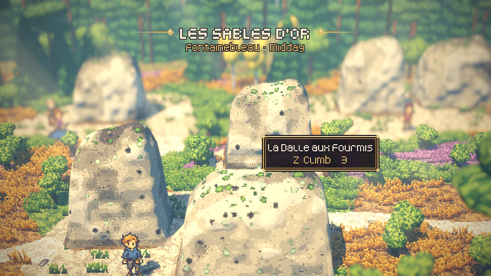
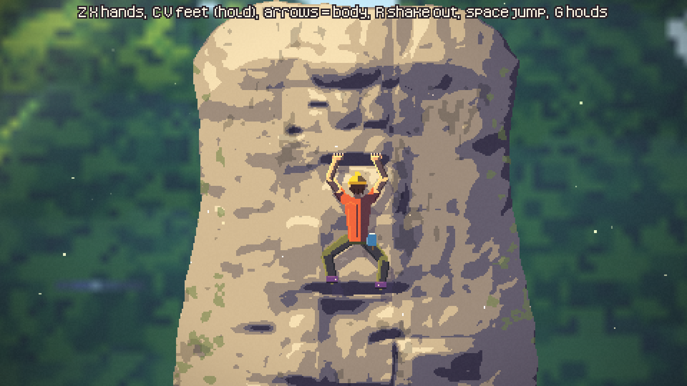
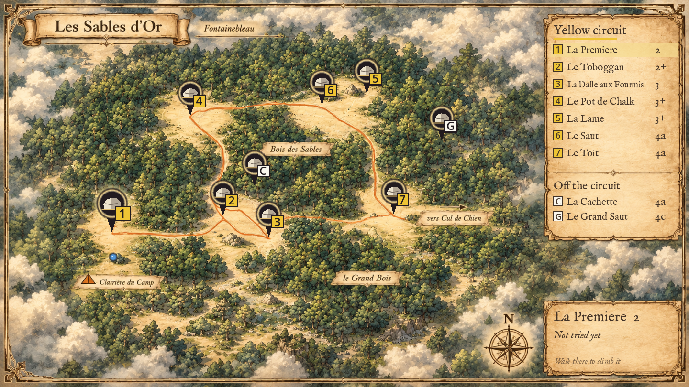

# Boulder

A calm pixel-art bouldering game set in the forest of Fontainebleau. Walk between the
sandstone blocks in a small HD-2D world, read the rock, and climb it hold by hold: where you
put each hand and foot, how you move your body, and how you pull on each hold.

> **Early prototype.** The first area, *Les Sables d'Or*, is playable from start to end.
> More areas are being built. Feedback is very welcome (see [Feedback](#feedback)).

## What is in it

- **Les Sables d'Or**, a clearing in the forest with a yellow circuit of seven problems
  (grades 2 to 4a). The circuit teaches one kind of hold at a time: rims and topping out,
  slopers, underclings and side pulls, then a block that asks for all three, a dyno and a roof.
- **Two hidden blocks** that people in the forest tell you about, or that you find yourself.
  One of them is a highball.
- **Climbing with hands and feet.** Holds have a direction: a sloper wants a straight pull
  down, an undercling a pull up, a side pull a lean away. On steep rock you hold body tension
  as you move. You can jump for far holds, and you top out with a mantle.
- **A topo** of the area with your logbook: attempts, flashes and sends. There are no timers
  anywhere: bouldering is about the send.
- Your progress is saved automatically.

## Play it

### Download

Download the build for your system from the [Releases](../../releases) page, unzip it and
start the game.

The builds are not signed, so your computer will warn you the first time:

- **macOS:** right-click the app, choose *Open*, then *Open* again. If macOS says the app is
  damaged or cannot be checked, open *System Settings → Privacy & Security* and click
  *Open Anyway*.
- **Windows:** if SmartScreen appears, click *More info*, then *Run anyway*.

### From the source

1. Install [Godot 4.7.2](https://godotengine.org/download) (the standard version, not .NET).
2. Clone this repository and open `project.godot` in Godot.
3. Press **F5** to play.

## Controls

A controller is recommended, but the keyboard works too.

**Walking**

| Action | Keyboard | Controller |
| --- | --- | --- |
| Walk | Arrow keys / WASD | Left stick / D-pad |
| Talk, start climbing | Z / Space / Enter | A |
| Back | X / Shift | B |
| Topo (map and logbook) | Tab / M | View |
| Next time of day | T | Y |
| Pause menu | Esc | Start |

**Climbing**

| Action | Keyboard | Controller |
| --- | --- | --- |
| Left / right hand (hold, aim, release) | Z / X | LB / RB |
| Left / right foot | C / V (hold) | LT / RT |
| Move your body | Arrow keys | Left stick |
| Jump (sink, then let go) | Space | A |
| Shake out an arm | R | Y |
| Body tension (steep rock) | F | B |
| Show how well each spot holds | G | View |
| Pause menu | Esc | Start |

The game shows hints while you learn, and each new kind of hold comes with a short tip.

## Feedback

This is the part I would love to hear about:

- Does the climbing feel good? Is it clear where you can hold and stand?
- Which block was too hard, too easy, or frustrating, and where did you get stuck?
- Did the tips and hints help, or get in the way?
- Anything that looked wrong or broke.

Open an issue on this repository, or send me a message.

## Credits

Made by [BoSchipper](https://github.com/BoSchipper).

Third-party parts and their licences are listed in
[THIRD_PARTY_NOTICES.md](THIRD_PARTY_NOTICES.md): shaders adapted from Lumina (MIT), menu
sounds from Ninja Adventure (CC0), the Kenney fonts (CC0) and IM FELL English (SIL OFL 1.1).
The characters were drawn with the help of an image AI and touched up by hand. The rock, the
grips and the world are generated by the tools in `tools/`.
